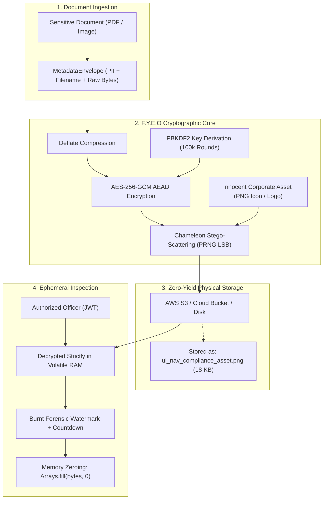

# 🛡️ F.Y.E.O Comprehensive Developer Guide (v3.0.2)

> *Part of the **Java for the Street (JFS)** ecosystem — Enterprise Code, Grassroots Soul.*  
> *Author: Adageje Moshood*

[](https://central.sonatype.com/artifact/io.github.mosh-py/fyeo-spring-boot-starter)
[](https://openjdk.org/)
[](LICENSE)
[]()

This guide is the definitive technical handbook for software engineers, backend architects, and security teams integrating **F.Y.E.O (*For Your Eyes Only*)** into enterprise Java and Spring Boot systems.

---

## Table of Contents
1. [The Problem: Why Traditional Storage Fails](#1-the-problem-why-traditional-storage-fails)
2. [Maven & Gradle Coordinates](#2-maven--gradle-coordinates)
3. [Pattern A: Pure Java Integration (fyeo-core)](#3-pattern-a-pure-java-integration-fyeo-core)
4. [Pattern B: Spring Boot Starter Integration (fyeo-spring-boot-starter)](#4-pattern-b-spring-boot-starter-integration-fyeo-spring-boot-starter)
5. [Key Management & The Anti-Rookie Security Rule](#5-key-management--the-anti-rookie-security-rule)
6. [Per-Document User PINs & Zero-Knowledge Vaults](#6-per-document-user-pins--zero-knowledge-vaults)
7. [Ephemeral RAM Inspection & Anti-Exfiltration Hygiene](#7-ephemeral-ram-inspection--anti-exfiltration-hygiene)
8. [AWS S3 / Cloud Bucket Storage Pattern](#8-aws-s3--cloud-bucket-storage-pattern)
9. [Verification via Local Playpen (fyeo-playpen)](#9-verification-via-local-playpen-fyeo-playpen)
10. [Troubleshooting & FAQs](#10-troubleshooting--faqs)

---

## 1. The Problem: Why Traditional Storage Fails

In typical banking and fintech applications, when a customer uploads a national identity card, passport, or CAC certificate:
1. **Network Transit is Encrypted (HTTPS/TLS)**: The green padlock glows in the browser.
2. **Backend Execution is Flawed**: The backend executes a simple file move (`Files.copy(file.getInputStream(), path)`).
3. **Storage Sits Naked**: Files sit in plaintext on raw server disks or S3 buckets (`Adeyemi_CAC_Certificate.pdf`).
4. **Cloud KMS Server-Side Encryption (SSE-S3) is an Illusion**: SSE only protects against someone physically stealing a hard drive from an AWS datacenter. If an attacker compromises an IAM role, API key, or finds an SSRF vulnerability, AWS transparently unmasks and delivers every document in plaintext.

### The F.Y.E.O Zero-Yield Paradigm


When an attacker breaches the server or dumps the storage bucket, they do not find sensitive PDFs. They find 10,000 identical 18 KB corporate UI icons. Zero readable citizen data. Zero metadata leakage.

---

## 2. Maven & Gradle Coordinates

Version **`3.0.2`** is officially published to **Maven Central**:

### Maven
```xml
<!-- Option 1: Spring Boot 3 / 2.7+ Applications -->
<dependency>
    <groupId>io.github.mosh-py</groupId>
    <artifactId>fyeo-spring-boot-starter</artifactId>
    <version>3.0.2</version>
</dependency>

<!-- Option 2: Pure Java / Quarkus / Micronaut / Android / CLI (Zero External Dependencies) -->
<dependency>
    <groupId>io.github.mosh-py</groupId>
    <artifactId>fyeo-core</artifactId>
    <version>3.0.2</version>
</dependency>
```

### Gradle
```groovy
// Spring Boot Starter
implementation 'io.github.mosh-py:fyeo-spring-boot-starter:3.0.2'

// Or Pure Java Core
implementation 'io.github.mosh-py:fyeo-core:3.0.2'
```

---

## 3. Pattern A: Pure Java Integration (`fyeo-core`)

If you are building a CLI, standalone microservice, or prefer full control without Spring magic, use the unified facade [`io.fyeo.core.FyeoVault`](file:///home/adageje-moshood/Documents/Moshood/personalSpringProject/fyeo-ecosystem/fyeo-core/src/main/java/io/fyeo/core/FyeoVault.java).

### A1. The Bill Pugh JVM Singleton Pattern
To ensure `FyeoVault` runs as a high-performance, thread-safe singleton initialized once per JVM classloader:

```java
package com.mybank.service;

import io.fyeo.core.FyeoVault;
import io.fyeo.core.model.ChameleonPayload;
import io.fyeo.core.model.MetadataEnvelope;

public class FileEncryptorService {

    // Bill Pugh Static Inner Holder: thread-safe, lazy-loaded by JVM
    private static class VaultHolder {
        private static final FyeoVault INSTANCE = FyeoVault.builder()
                .masterKey(System.getenv("APP_MASTER_KEY")) // Injected from secret store
                .maxPixels(500_000)
                .watermarkTemplate("RESTRICTED • %username% • %timestamp% • Anti-Leak")
                .build();
    }

    public static FyeoVault getVault() {
        return VaultHolder.INSTANCE;
    }

    /**
     * Cloaks an incoming document into an innocent PNG carrier.
     */
    public byte[] cloak(byte[] documentBytes, String filename, String customerId) {
        MetadataEnvelope envelope = new MetadataEnvelope(
                filename,
                customerId,
                "CAC_CERTIFICATE",
                System.currentTimeMillis(),
                documentBytes
        );

        // Cloaks into default corporate decoy asset
        ChameleonPayload payload = getVault().cloakDocument(envelope, null);
        return payload.getCarrierBytes();
    }

    /**
     * Uncloaks document bytes strictly in memory.
     */
    public MetadataEnvelope uncloak(byte[] carrierBytes) {
        return getVault().uncloakDocument(carrierBytes, null);
    }
}
```

---

## 4. Pattern B: Spring Boot Starter Integration (`fyeo-spring-boot-starter`)

With `fyeo-spring-boot-starter`, the vault service is auto-configured out of the box with zero boilerplate.

### B1. Configuration (`application.yml`)
```yaml
fyeo:
  vault:
    enabled: true
    # Mandatory in Production: Inject via Environment Variable or AWS Secrets Manager
    master-key: ${FYEO_VAULT_MASTER_KEY:DevSecretKeyMinimum32Characters#2026}
    # Memory cap for visual processing (prevents OOM on massive image attacks)
    max-pixels: 500000
    # Ephemeral view window (seconds) before memory zeroing
    ephemeral-view-duration-seconds: 15
    watermark:
      template: "CONFIDENTIAL • %username% • %timestamp% • Bank Compliance"
```

### B2. Production KYC Ingestion Controller
```java
package com.mybank.controller;

import io.fyeo.core.model.ChameleonPayload;
import io.fyeo.core.model.MetadataEnvelope;
import io.fyeo.starter.FyeoVaultService;
import org.springframework.beans.factory.annotation.Autowired;
import org.springframework.http.ResponseEntity;
import org.springframework.web.bind.annotation.*;
import org.springframework.web.multipart.MultipartFile;

import java.io.IOException;
import java.nio.file.Files;
import java.nio.file.Paths;

@RestController
@RequestMapping("/api/kyc")
public class KycIngestionController {

    private final FyeoVaultService fyeoVaultService;

    @Autowired
    public KycIngestionController(FyeoVaultService fyeoVaultService) {
        this.fyeoVaultService = fyeoVaultService;
    }

    @PostMapping("/upload")
    public ResponseEntity<UploadResponse> uploadKycDocument(
            @RequestParam("file") MultipartFile file,
            @RequestParam("customerName") String customerName,
            @RequestParam("documentType") String documentType) throws IOException {

        // 1. Encapsulate original filename, customer identity, and binary bytes
        MetadataEnvelope envelope = new MetadataEnvelope(
                file.getOriginalFilename(),
                customerName,
                documentType,
                System.currentTimeMillis(),
                file.getBytes()
        );

        // 2. Cloak into an innocent corporate carrier asset (AES-256-GCM + Stego-AEAD)
        ChameleonPayload payload = fyeoVaultService.protectDocumentWithEnvelope(envelope, null);

        // 3. Generate benign decoy key (e.g. "ui_nav_compliance_asset_101.png")
        String storageKey = fyeoVaultService.generateChameleonDecoyKey(101);

        // 4. Save harmless PNG asset to disk or S3
        Files.write(Paths.get("/var/storage/kyc/" + storageKey), payload.getCarrierBytes());

        return ResponseEntity.ok(new UploadResponse(storageKey, "Cloaked as harmless UI asset"));
    }
}
```

---

## 5. Key Management & The Anti-Rookie Security Rule

### Kerckhoffs's Principle
> *"A cryptosystem must be secure even if everything about the system, except the key, is public knowledge."*

Because F.Y.E.O is open-source on Maven Central under Apache 2.0, attackers can inspect the code. But **the algorithm is not the secret—the key is the secret**.

If an attacker dumps your database or S3 bucket and attempts to uncloak your files using the F.Y.E.O JAR:
```java
FyeoVault hackerVault = new FyeoVault("WRONG_OR_GUESS_KEY");
hackerVault.uncloakRawBytes(stolenDecoyBytes);
```
Java halts immediately:
```text
javax.crypto.AEADBadTagException: Tag mismatch!
```
The AES-256-GCM authentication tag fails. Decryption halts inside RAM, and **zero plaintext bytes are ever returned**.

### ⚠️ The Anti-Rookie Rule: NEVER Deploy with Default Keys
F.Y.E.O includes fallback keys (`DEFAULT_MASTER_KEY`) so new developers can test without setup. 
**If you deploy with the default key in production, any attacker who downloads the F.Y.E.O JAR can uncloak your documents.**

**Production Requirements:**
1. Always inject `FYEO_VAULT_MASTER_KEY` via an environment variable, HashiCorp Vault, or AWS Secrets Manager.
2. Minimum entropy: At least 32 characters or a cryptographically random 256-bit hexadecimal string.
3. Key stretching: F.Y.E.O automatically runs all keys through **PBKDF2WithHmacSHA256** with 100,000 iterations and salt before generating the AES-256-GCM key.

---

## 6. Per-Document User PINs & Zero-Knowledge Vaults

Some regulatory regimes (e.g., NDPR, GDPR) require that **only the end-user** possesses the decryption key, meaning even bank staff and cloud administrators cannot view the file without the customer's PIN.

### Cloaking with a User PIN
```java
String userEnteredPin = "849201"; // Customer's private PIN

// Create a transient vault instance scoped to the customer's PIN
FyeoVault pinVault = new FyeoVault(userEnteredPin);
ChameleonPayload cloaked = pinVault.cloakDocument(rawFileBytes, null);

// Store cloaked.getCarrierBytes() in S3...
```

### Uncloaking with Key Override
When retrieving the file, pass the user's PIN into `uncloakRawBytes`:
```java
// Uses the global vault but overrides the active key with the caller's PIN:
byte[] plainBytes = globalVault.uncloakRawBytes(storedDecoyBytes, userEnteredPin);
```
- If the customer enters `"849201"`: Verification succeeds, bytes returned.
- If an admin or hacker tries `"000000"`: Throws `AEADBadTagException`, zero leakage.

---

## 7. Ephemeral RAM Inspection & Anti-Exfiltration Hygiene

When an authorized compliance officer or KYC auditor needs to verify a document, you must **never** write temporary decrypted files to OS temp folders (`/tmp/`) or disk caches.

### In-Memory Streaming & Forensic Watermarking
```java
@GetMapping(value = "/api/kyc/{storageKey}/inspect", produces = MediaType.APPLICATION_PDF_VALUE)
public ResponseEntity<byte[]> inspectDocument(
        @PathVariable String storageKey,
        @RequestHeader("X-Reviewer-Email") String reviewerEmail) throws IOException {

    byte[] decoyBytes = Files.readAllBytes(Paths.get("/var/storage/kyc/" + storageKey));

    // 1. Decrypt strictly in volatile memory
    MetadataEnvelope envelope = fyeoVaultService.restoreDocumentEnvelope(decoyBytes);

    // 2. Generate dynamic forensic watermark with ISO-8601 timestamp
    String watermark = fyeoVaultService.renderWatermark(reviewerEmail, storageKey);

    return ResponseEntity.ok()
            .header("X-Forensic-Watermark", watermark)
            .header("X-Ephemeral-TTL-Seconds", String.valueOf(fyeoVaultService.getEphemeralViewDurationSeconds()))
            .header(HttpHeaders.CONTENT_DISPOSITION, "inline; filename=\"" + envelope.getOriginalFilename() + "\"")
            .body(envelope.getImageBytes());
}
```

### Memory Zeroing (Anti-RAM Dumping)
To protect against cold-boot attacks and JVM heap dumps, zero out sensitive byte arrays once processing concludes:
```java
byte[] decryptedData = envelope.getImageBytes();
try {
    // Process or stream bytes...
} finally {
    // Zero out memory to prevent forensic remnants in RAM swap
    Arrays.fill(decryptedData, (byte) 0);
}
```

---

## 8. AWS S3 / Cloud Bucket Storage Pattern

Integrating with the AWS SDK v2 (`software.amazon.awssdk:s3`):

```java
package com.mybank.service;

import io.fyeo.core.model.ChameleonPayload;
import io.fyeo.core.model.MetadataEnvelope;
import io.fyeo.starter.FyeoVaultService;
import org.springframework.beans.factory.annotation.Autowired;
import org.springframework.beans.factory.annotation.Value;
import org.springframework.stereotype.Service;
import software.amazon.awssdk.core.sync.RequestBody;
import software.amazon.awssdk.services.s3.S3Client;
import software.amazon.awssdk.services.s3.model.PutObjectRequest;

@Service
public class S3KycVaultService {

    @Autowired
    private S3Client s3Client;

    @Autowired
    private FyeoVaultService fyeoVaultService;

    @Value("${aws.s3.kyc-bucket}")
    private String bucketName;

    public String storeKycInS3(String customerName, String filename, byte[] documentBytes) {
        MetadataEnvelope envelope = new MetadataEnvelope(
                filename,
                customerName,
                "CAC_CERTIFICATE",
                System.currentTimeMillis(),
                documentBytes
        );

        // Cloak document into innocent PNG
        ChameleonPayload cloaked = fyeoVaultService.protectDocumentWithEnvelope(envelope, null);

        // Innocent S3 Key (appears as corporate UI icon)
        String s3Key = "ui/assets/icons/nav_compliance_asset_" + System.currentTimeMillis() + ".png";

        PutObjectRequest putRequest = PutObjectRequest.builder()
                .bucket(bucketName)
                .key(s3Key)
                .contentType("image/png")
                .build();

        s3Client.putObject(putRequest, RequestBody.fromBytes(cloaked.getCarrierBytes()));
        return s3Key;
    }
}
```

---

## 9. Verification via Local Playpen (`fyeo-playpen`)

A complete runnable testing CLI playground is provided in the repository at [`fyeo-playpen`](file:///home/adageje-moshood/Documents/Moshood/personalSpringProject/fyeo-playpen/).

To test the entire encryption and decryption lifecycle on your local terminal:

```bash
cd fyeo-playpen

# Run the live cloaking and bit-parity verification CLI
mvn clean compile exec:java
```

**Expected Output:**
```text
======================================================================
  F.Y.E.O (For Your Eyes Only) — Playpen CLI Verification
  Movement: Java for the Street 🛣️☕️
  Ecosystem Version: 3.0.2 (Maven Central)
======================================================================
[STEP 1] Generating raw CAC Incorporation Certificate sample...
   Created: cac_certificate_sample.txt (224 bytes)

[STEP 2] Cloaking document into innocent PNG decoy carrier...
   Vault Singleton Instance ID: 708890004
   Decoy PNG Dimensions: 400x400 (160000 pixels)
   Saved cloaked asset: output/cloaked_document.png (18320 bytes)
   Verification: File on disk is a 100% valid PNG image!

[STEP 3] Uncloaking document strictly in volatile RAM...
   Uncloaked Payload Size: 224 bytes
   Content: [CAC Certificate Plaintext Content Verified]

[STEP 4] Bit-level cryptographic parity verification...
   Comparing input byte-for-byte with decrypted RAM output...
   MATCH! Output matches input with 100.00% cryptographic parity!
```

---

## 10. Troubleshooting & FAQs

### Q: `AEADBadTagException: Tag mismatch!`
- **Cause**: The key or PIN used to uncloak does not match the key used to cloak, or the decoy PNG was re-compressed (e.g. converted to lossy JPEG or passed through an aggressive WebP optimizer).
- **Remedy**: Always store and transport cloaked assets as lossless PNG (`image/png`). Do not pass through image lossy compressors. Verify the master key or user PIN matches.

### Q: `IllegalArgumentException: Document byte size exceeds carrier capacity!`
- **Cause**: The sensitive file is larger than the pixel budget of the carrier image.
- **Remedy**: Each pixel can store 3 bits across RGB channels. Increase `fyeo.vault.max-pixels` in `application.yml` (e.g. `2000000` for 2 Megapixels) or use a higher-resolution carrier image.

### Q: Does F.Y.E.O work with PDF files?
- **Yes**: F.Y.E.O is binary-format agnostic. PDFs, DOCX, ZIPs, PNGs, and JPEGs are treated as raw binary streams (`byte[]`), deflated, encrypted with AES-256-GCM, and embedded into carrier images.

---

### Movement Signature

```text
Enterprise Code. Grassroots Soul.
Java for the Street. 🛣️☕️
```
